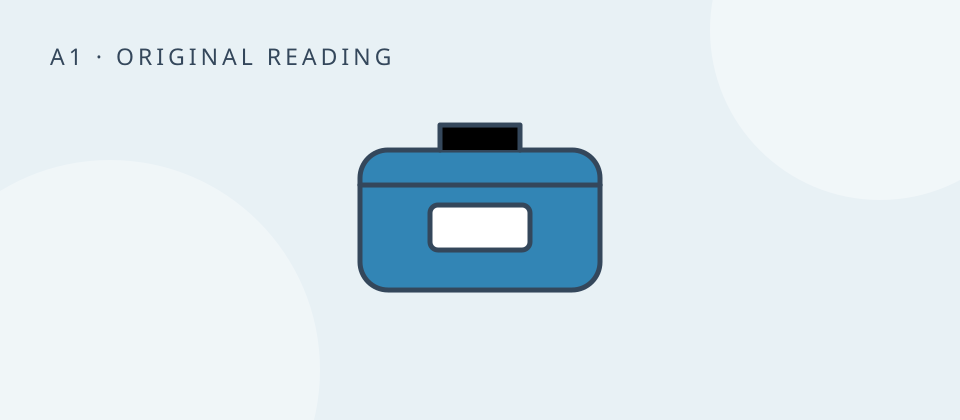
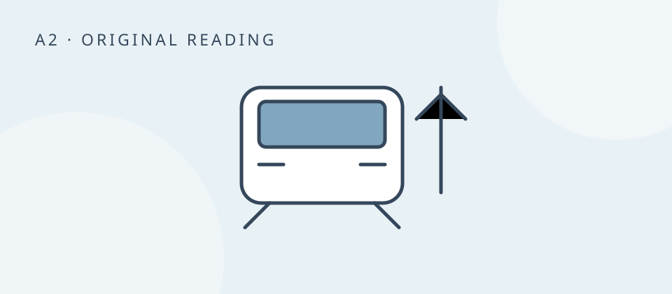
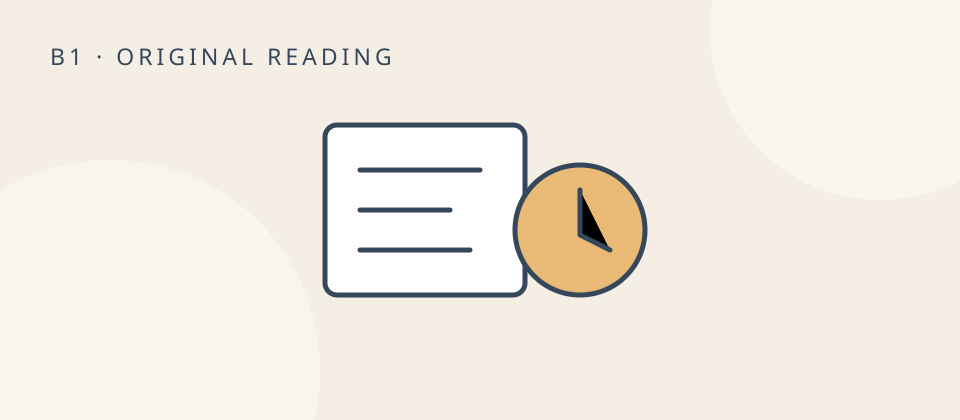
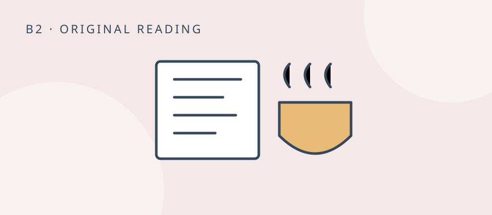

# Original English readings — draft review

All 16 production works are unpublished. Previous active readings were soft-deleted using the existing library mechanism; their content and history remain recoverable. No third-party text or artwork was copied.

Each reading uses one existing work and one unit. Reading times use the existing 200 words/minute estimate (rounded, minimum one minute); learners may take longer when collecting vocabulary. Source URLs are intentionally empty because these texts are original.

| Level | Title / admin editor | Type | Topics | Estimated minutes |
|---|---|---|---|---:|
| A1 | [The Blue Lunch Box](https://omnicaenglish.com/admin/library/works/rh74vafntph15bdsvmchja7d3n8g0zh7) | story | daily-life, work, food | 1 |
| A1 | [Two Tickets, Please](https://omnicaenglish.com/admin/library/works/rh7b34h2x6bk7dkfay6kb802md8g1zgh) | dialog | travel, practical-conversations | 1 |
| A1 | [A Quiet Place for Tea](https://omnicaenglish.com/admin/library/works/rh77sn79h6j27zan0epr5b84jh8g1dck) | story | relationships, daily-life | 1 |
| A1 | [No Onions in My Sandwich](https://omnicaenglish.com/admin/library/works/rh74e9f66pgc6rnpfv1dj4mgxn8g03a8) | dialog | food, practical-conversations | 1 |
| A2 | [The Wrong Platform](https://omnicaenglish.com/admin/library/works/rh7f63rgjazjspcp3e8dvfhcsn8g182e) | story | travel, practical-conversations | 1 |
| A2 | [Can We Move the Meeting?](https://omnicaenglish.com/admin/library/works/rh7345684xn29019v046946ck58g026z) | dialog | work, practical-conversations | 1 |
| A2 | [Dinner from What You Have](https://omnicaenglish.com/admin/library/works/rh78xcpgpcf9w43n8f1qkd5jbd8g19zc) | article | food, daily-life | 1 |
| A2 | [The Saturday We Didn't Plan](https://omnicaenglish.com/admin/library/works/rh7ays5wjxf38ge97dyxq38nsn8g0svq) | story | relationships, leisure | 1 |
| B1 | [A Parcel for Number Twelve](https://omnicaenglish.com/admin/library/works/rh7ajc8h2shx5fm7330egah22h8g1zqe) | story | daily-life, relationships | 2 |
| B1 | [The Deadline Is Still Friday](https://omnicaenglish.com/admin/library/works/rh7cpfpwp8atf3jbakpbx57f2n8g09dv) | dialog | work, practical-conversations | 2 |
| B1 | [A Better Way to Split the Bill](https://omnicaenglish.com/admin/library/works/rh79hnx01hzprprfjm0kc7ccnd8g1wvf) | article | food, relationships, money | 1 |
| B1 | [One Afternoon without a Map](https://omnicaenglish.com/admin/library/works/rh7fw3pmwa1k7dmq7ctv67m6n98g16a5) | story | travel, leisure | 1 |
| B2 | [The Hidden Work of Being Available](https://omnicaenglish.com/admin/library/works/rh748q2e8735j3hg8g1qgh60th8g11qs) | article | work, technology, relationships | 2 |
| B2 | [The Cheapest Room in the City](https://omnicaenglish.com/admin/library/works/rh72q7k3m729f04vh6dk6gc16h8g1wyx) | story | travel, money, practical-conversations | 2 |
| B2 | [An Apology with a Next Step](https://omnicaenglish.com/admin/library/works/rh75hw78wxcaf8vb2z0nqvb16h8g0f73) | dialog | relationships, work, practical-conversations | 2 |
| B2 | [When a Family Recipe Travels](https://omnicaenglish.com/admin/library/works/rh73dw4zpn6efvwsw7ewycbcp98g0x67) | article | food, culture, relationships | 2 |

Verified 11 October 2026: all 16 production admin previews render; production has 16 unique drafts and zero published works. The existing development QA learner collected “cupboard” from the draft preview, saw its Arabic translation in My Words and on the flashcard back with the original sentence, and completed a review. The production collection was never published for testing. Admin preview also fits a 375px viewport without horizontal scrolling.

## Representative readings

### A1 — The Blue Lunch Box

A new colleague finds a simple way to start a conversation at lunch.

It is twelve o'clock. Lina is in the kitchen at work. Her lunch is in a blue box. She has rice, chicken and a small tomato.

A man comes into the kitchen. He has a blue box too.

"Hello. Is this your lunch?" he asks.

Lina looks at his box. There is a white star on it.

"No. My box has my name on it. Look: Lina."

"I'm Adam. This is my first day. Where can I sit?"

"Here. This chair is free."

Adam opens his box. He has bread, cheese and an apple.

"There is hot water over there," Lina says. "Do you want tea?"

"Yes, please. Where are the cups?"

"In the cupboard, next to the window."

They sit at the small table. Adam asks about the office. Lina asks about his family. Lunch is only twenty minutes, but Adam now knows one person at work.

Before they leave, he writes his name on his box.

### A2 — The Wrong Platform

A traveller deals with a platform change without missing her train.

When Hana arrived at the station, the screen said that her train left from platform three. She bought a bottle of water and walked there with her suitcase. She was visiting a friend in another city for the weekend.

Ten minutes later, a message came from the loudspeaker. Hana heard the name of her destination, but she couldn't understand the rest. People around her started moving.

She showed her ticket to a station worker.

"Excuse me. Is this the right platform for my train?"

"Not now. There's a platform change. You need platform six."

"Do I have to go up the stairs? My suitcase is quite heavy."

"You can take the lift. It's behind you, next to the newsagent's. Go up one floor, then follow the signs."

Hana thanked him and checked the time. She still had twelve minutes. At the lift, an older woman was looking at the same ticket.

"Are you going to platform six too?" Hana asked.

The woman nodded. They travelled up together and found the platform without running. Their train was already there, but the doors were open.

After Hana found her seat, she sent her friend a message: "I'm on the train. Small adventure at the station!"

Then she put her suitcase away. Next time, she decided, she would check the screen again just before getting on.

### B1 — The Deadline Is Still Friday

A junior colleague raises a workload problem and negotiates a realistic deadline.

Nadia has been asked to prepare a customer report by Friday. On Wednesday, her manager adds a presentation to her task list. After checking the work remaining, Nadia asks for a short conversation.

Nadia: Can we look at my priorities? I can finish the report by Friday, but the presentation will take another full day.

Manager: I thought you could use the figures from the report. Wouldn't that make it quicker?

Nadia: The figures will help. But the presentation needs charts and a different structure. I also need to check which customer details we can share.

Manager: Fair point. The sales team wants it for Monday morning.

Nadia: Is the report needed before then too?

Manager: Yes. Finance is using it on Friday afternoon.

Nadia: Then I see two options. I could send the report on Friday and a simple presentation on Monday afternoon. Or someone could help with the charts tomorrow, and I could finish both by Friday.

Manager: What do you mean by a simple presentation?

Nadia: Six slides with the main findings. No separate examples for each region. We can add those later if the team needs them.

Manager: Monday afternoon is too late. Their meeting is at nine. I'll ask Omar whether he has time to help tomorrow.

Nadia: Thanks. If he can prepare the charts, I can write the slide text. Could you confirm the audience? That will help us choose the right details.

Manager: It's the internal sales team, including the regional managers. I'll send you the list.

Nadia: Great. I'll send Omar the checked figures by eleven tomorrow. If he's unavailable, I'll let you know before lunch so we can make another plan.

After the conversation, Nadia sends a brief message confirming who will do each task. The deadline hasn't moved, but the amount of work is now shared. She returns to the report knowing exactly what she needs to finish first.

### B2 — When a Family Recipe Travels

A family disagreement over an ingredient explores memory, adaptation and belonging.

When Rania sent her mother a photograph of dinner, she expected a heart emoji. Instead, the reply came almost immediately: "What have you put in the filling?"

Rania was living abroad and had made the stuffed vegetables she remembered from home. The familiar herbs were difficult to find near her flat, so she had used a different mixture. She had also cooked them in a wide frying pan because she didn't own a large pot. Her mother recognised the dish, but not quite the version on the screen.

Food often carries instructions that are never written down. A recipe may list the ingredients, yet leave out how tightly to pack the vegetables, when to lower the heat, or what "a little" salt means. These details are learnt by watching someone whose movements seem too ordinary to explain.

Distance changes that process. Rania couldn't stand beside her mother at the cooker. Instead, they exchanged photographs and voice messages. Her mother told her to listen for the sound of the liquid bubbling and showed her how to judge when the filling was ready. Rania explained the ingredients available in her neighbourhood and the equipment she could afford.

At first, each treated the differences as mistakes. Her mother worried that the family dish was becoming something else. Rania felt that every substitution was being judged as a failure to remember home properly. Neither was really arguing about herbs alone.

Their conversations became easier when they separated two questions: what creates the dish's characteristic flavour, and what can change without losing the pleasure of eating it? Some choices mattered to both of them. Others turned out to be habits rather than necessities.

A month later, Rania invited friends for dinner. She described the food as her version of a family recipe and explained the changes without apologising for them. One guest asked for written instructions. Rania made two columns in her notebook: "What my mother uses" and "What I can find here".

She sent the page home. This time, her mother replied with a photograph of her own dinner. She had tried Rania's method in the frying pan because it was easier to wash.

A recipe can preserve a connection without preserving every movement unchanged. In this family, the conversation around the dish became part of what was passed on.

